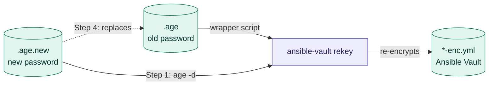

# Change an Ansible Vault master password

This guide rotates the master password of one Ansible Vault (`global` or `personal`) in the setup described in `Ansible_Vault.md`:

1. Generate a new master password and encrypt it with `age`.
2. Re-encrypt (rekey) the Ansible Vault with the new password.
3. Put the new encrypted password in place and test.
4. Clean up, or roll back if something failed.

At no point is the cleartext password written to disk or to your shell history.



## When to rotate

* A team member who could decrypt the `global` password leaves the team, or their SSH key is lost or compromised.
* The cleartext password was exposed (pasted in a chat, committed, left in a file).
* Your regular rotation schedule says so.

> ⚠️ **Rotating the master password doesn't revoke what someone already has.** Anyone who could decrypt the vault before may have kept a copy of its contents, and old encrypted copies stay in Git history. If the rotation is because someone left or a key was compromised, also change the **secrets inside the vault** (switch passwords, CloudVision tokens) on the devices and services themselves.

## Prerequisites

Run everything inside the DevContainer, from the repo root:

```bash
cd /workspaces/Ansible-Vault
export ANSIBLE_CONFIG="/workspaces/Ansible-Vault/ansible.cfg"
```

Check that the current setup works **before** you change anything. Both commands must succeed:

```bash
scripts/vault_wrapper-client.sh --vault-id global
ansible-vault view global_vars/global-ansible-vault-enc.yml
```

If they fail, fix that first with the *Troubleshooting* section of `Ansible_Vault.md`. The rekey uses the wrapper script to get the **old** password.

## Step 0: Set the variables

Pick the vault you're rotating. Every command after this uses these variables.

**For the `global` vault** (password encrypted for the whole team):

```bash
VAULT_ID="global"
RECIPIENTS=".secrets/team_ssh_keys.txt"
```

**For the `personal` vault** (password encrypted only for you):

```bash
VAULT_ID="personal"
RECIPIENTS="${HOME}/.ssh/id_ed25519_vault_lab.pub"
```

Then, for both:

```bash
AGE_FILE=".secrets/.${VAULT_ID}-ansible-vault.age"
VAULT_FILE="global_vars/${VAULT_ID}-ansible-vault-enc.yml"
KEY_NAME="${VAULT_ID}-secrets"   # name of the cached SSH key in the kernel keyring
```

> 📌 For `global`, review `team_ssh_keys.txt` now: **remove** the key of anyone who should no longer have access, and add new members. The new password will be encrypted only for the keys in that file.

Make sure your SSH private key is cached, so `age` doesn't prompt for the passphrase several times:

```bash
scripts/ssh_key_cache.py stats --name "${KEY_NAME}" \
  || scripts/ssh_key_cache.py store ~/.ssh/id_ed25519_vault_lab --hours 1 --name "${KEY_NAME}"
```

## Step 1: Find every file encrypted with this vault ID

`ansible-vault rekey` only changes the files you give it. Any file left out stays encrypted with the old password and will fail later. Ansible writes the vault ID in the first line of each encrypted file, so you can search for it:

```bash
grep -rlxF --exclude-dir=.git "\$ANSIBLE_VAULT;1.2;AES256;${VAULT_ID}" .
```

Normally this lists only `${VAULT_FILE}`. If it lists more files, add them to the `rekey` command in Step 4.

> ⚠️ `rekey` doesn't handle **inline** encrypted variables (`!vault |` blocks inside a normal YAML file). If you have any, search for them with `grep -rn '!vault' .` and re-create them with `ansible-vault encrypt_string`.

## Step 2: Back up the current files

Keep a copy of the old encrypted password and the old vault, so you can roll back:

```bash
cp -p "${AGE_FILE}"   "${AGE_FILE}.old"
cp -p "${VAULT_FILE}" "${VAULT_FILE}.bak"
```

> 📌 Neither backup gets committed: `${AGE_FILE}.old` is inside the ignored `.secrets/` directory, and `${VAULT_FILE}.bak` matches `*vault*` in `.gitignore`. You'll delete both in Step 7.

## Step 3: Create and encrypt the new master password

**Option A: generate a random password (recommended).** The password goes straight from the random generator into `age`, so it never exists in a file, on screen or in your history:

```bash
umask 077
head -c 32 /dev/urandom | base64 -w 0 \
  | age -R "${RECIPIENTS}" \
  | base64 -w 0 > "${AGE_FILE}.new"
```

**Option B: choose the password yourself.** Type it in `vi`, then encrypt and shred the cleartext file:

```bash
INPUT_FILE=".secrets/.${VAULT_ID}-ansible-vault.txt"
vi "${INPUT_FILE}"
age -R "${RECIPIENTS}" "${INPUT_FILE}" | base64 -w 0 > "${AGE_FILE}.new"
shred -u -v -n 3 "${INPUT_FILE}"
```

> ⛔ Don't use `echo "new-password" > file`: the password ends up in your shell history.

Check that you can decrypt the new file. The first command prints the **new** password, and the second still prints the **old** one (the wrapper hasn't been switched yet). They must be different:

```bash
base64 -d "${AGE_FILE}.new" | age -d -i <(scripts/ssh_key_cache.py get --name "${KEY_NAME}"); echo
scripts/vault_wrapper-client.sh --vault-id "${VAULT_ID}"; echo
```

## Step 4: Re-encrypt the Ansible Vault with the new password

`ansible-vault rekey` decrypts the vault with the old password and encrypts it again with the new one, in place:

* The **old** password comes from the wrapper script, through `vault_identity_list` in `ansible.cfg`. The wrapper still reads `${AGE_FILE}`, which holds the old password.
* The **new** password is decrypted from `${AGE_FILE}.new` and handed to Ansible through a pipe (`<(...)`), so it never touches the disk.

```bash
ansible-vault rekey \
  --new-vault-id "${VAULT_ID}@"<(base64 -d "${AGE_FILE}.new" | age -d -i <(scripts/ssh_key_cache.py get --name "${KEY_NAME}")) \
  "${VAULT_FILE}"
```

Expected output:

```text
Rekey successful
```

> 📌 If Step 1 found other files for this vault ID, list them all at the end of the command.  
> 📌 The vault ID label stays the same. Check the first line of the file: `head -1 "${VAULT_FILE}"` must end with `;${VAULT_ID}`.  

If the rekey fails, **stop**: nothing has been changed yet. Delete `${AGE_FILE}.new` and fix the error.

## Step 5: Put the new encrypted password in place

Now the vault is encrypted with the new password, so the wrapper must return the new one:

```bash
mv "${AGE_FILE}.new" "${AGE_FILE}"
```

## Step 6: Test

**1. The wrapper returns the new password:**

```bash
scripts/vault_wrapper-client.sh --vault-id "${VAULT_ID}"; echo
```

**2. Ansible can read the vault with the new password:**

```bash
ansible-vault view "${VAULT_FILE}"
```

**3. The contents didn't change.** Compare the rotated vault with the backup, which still opens with the old password:

```bash
diff \
  <(ansible-vault view "${VAULT_FILE}") \
  <(ANSIBLE_VAULT_IDENTITY_LIST="${VAULT_ID}@"<(base64 -d "${AGE_FILE}.old" | age -d -i <(scripts/ssh_key_cache.py get --name "${KEY_NAME}")) \
      ansible-vault view "${VAULT_FILE}.bak") \
  && echo "✅ Contents identical"
```

**4. The old password no longer works.** This command must **fail** with `Decryption failed (no vault secrets were found that could decrypt)`:

```bash
ANSIBLE_VAULT_IDENTITY_LIST="${VAULT_ID}@"<(base64 -d "${AGE_FILE}.old" | age -d -i <(scripts/ssh_key_cache.py get --name "${KEY_NAME}")) \
  ansible-vault view "${VAULT_FILE}"
```

**5. A playbook can use both vaults together:**

```bash
ansible-playbook -i localhost, -c local -e "user=DDN" playbooks/verify_global_secrets.yml
```

> 📌 `ANSIBLE_VAULT_IDENTITY_LIST=...` on the same line as a command overrides `vault_identity_list` from `ansible.cfg` for that command only, so tests 3 and 4 use **only** the old password.

## Step 7: Clean up

When every test passes, remove the backups:

```bash
shred -u -n 3 "${AGE_FILE}.old"
rm -f "${VAULT_FILE}.bak"
```

Then commit the re-encrypted vault, if your vaults are tracked in Git:

```bash
git add -f "${VAULT_FILE}"   # -f because *vault* is in .gitignore
git commit -m "Rotate ${VAULT_ID} Ansible Vault master password"
git push
```

**For the `global` vault, tell the team.** Everyone needs the new `.secrets/.global-ansible-vault.age` (it isn't in Git, since `.secrets/` is ignored). Send it through your usual channel: it's safe to share, because only the keys in `team_ssh_keys.txt` can decrypt it. Until they replace their copy, their wrapper returns the old password and Ansible fails with `Decryption failed`.

## Rollback

If a test in Step 6 fails, restore both files together:

```bash
mv "${AGE_FILE}.old"   "${AGE_FILE}"
mv "${VAULT_FILE}.bak" "${VAULT_FILE}"
rm -f "${AGE_FILE}.new"
```

Then check that the old setup works again:

```bash
ansible-vault view "${VAULT_FILE}"
```

> ⚠️ Always restore the `.age` file and the vault **as a pair**. A vault encrypted with the new password and an `.age` file holding the old one (or the other way around) can't be opened, and if you've already deleted the backups, the vault's contents are lost.

## Quick reference

```bash
cd /workspaces/Ansible-Vault
VAULT_ID="global"; RECIPIENTS=".secrets/team_ssh_keys.txt"
# VAULT_ID="personal"; RECIPIENTS="${HOME}/.ssh/id_ed25519_vault_lab.pub"
AGE_FILE=".secrets/.${VAULT_ID}-ansible-vault.age"
VAULT_FILE="global_vars/${VAULT_ID}-ansible-vault-enc.yml"
KEY_NAME="${VAULT_ID}-secrets"
DECRYPT_KEY() { scripts/ssh_key_cache.py get --name "${KEY_NAME}"; }

cp -p "${AGE_FILE}" "${AGE_FILE}.old"; cp -p "${VAULT_FILE}" "${VAULT_FILE}.bak"
umask 077
head -c 32 /dev/urandom | base64 -w 0 | age -R "${RECIPIENTS}" | base64 -w 0 > "${AGE_FILE}.new"
ansible-vault rekey --new-vault-id "${VAULT_ID}@"<(base64 -d "${AGE_FILE}.new" | age -d -i <(DECRYPT_KEY)) "${VAULT_FILE}"
mv "${AGE_FILE}.new" "${AGE_FILE}"
ansible-vault view "${VAULT_FILE}"
shred -u -n 3 "${AGE_FILE}.old"; rm -f "${VAULT_FILE}.bak"
```
