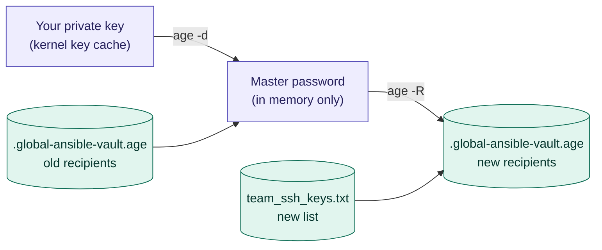

# Add or remove an SSH public key

The global Ansible Vault master password is encrypted with `age` for every SSH public key in `.secrets/team_ssh_keys.txt`. Any **one** of the matching private keys can decrypt it.

Editing `team_ssh_keys.txt` on its own changes nothing: the encrypted password in `.secrets/.global-ansible-vault.age` still has the old list of recipients baked in. After every change to the list, you must **re-encrypt** the master password for the new list.

This guide covers:

* [How it works](#how-it-works)
* [Add a key](#add-a-key) and [remove a key](#remove-a-key), with the `manage_team_keys.py` script
* [Doing it by hand](#doing-it-by-hand), without the script
* [Script reference](#script-reference)
* [Troubleshooting](#troubleshooting)

> 📌 This applies to the **global** vault. The personal vault's master password is encrypted only for your own key, so there's nobody to add or remove. To change your own key, see [Replace your own key](#replace-your-own-key).

## How it works



1. You decrypt the current master password with **your** private key. You can only change the list if you're already on it.
2. The password is re-encrypted for every key in the new `team_ssh_keys.txt`.
3. The new `.age` file replaces the old one.

The master password itself doesn't change, so the Ansible Vault doesn't need to be touched. The exception is when you remove someone: see [Remove a key](#remove-a-key).

## Before you start

Run everything inside the DevContainer, from the repo root:

```bash
cd /workspaces/Ansible-Vault
```

Install the script (once):

```bash
cp manage_team_keys.py scripts/
chmod +x scripts/manage_team_keys.py
```

Make sure your SSH private key is in the kernel key cache, and that you can decrypt the password and open the vault:

```bash
scripts/ssh_key_cache.py store ~/.ssh/id_ed25519_vault_lab --hours 1 --name global-secrets
scripts/manage_team_keys.py verify
```

Expected output:

```text
✅ Your kernel key cache 'global-secrets' decrypts /workspaces/Ansible-Vault/.secrets/.global-ansible-vault.age
✅ /workspaces/Ansible-Vault/global_vars/global-ansible-vault-enc.yml opens with that password
```

> 📌 If you don't use the key cache, add `--identity ~/.ssh/id_ed25519_vault_lab` to any command. `age` then asks for your key's passphrase.

## Add a key

### 1. Get the new member's public key

Ask them for their **public** key: the `.pub` file, for example `~/.ssh/id_ed25519_vault_lab.pub`. It's safe to send by email or chat.

> ⚠️ Never accept or ask for a private key. The script refuses one if you pass it by mistake.

Check the key's fingerprint with them over a **second channel** (a call, or in person), so nobody can slip in their own key:

```bash
ssh-keygen -l -f alice.pub
```

They run `ssh-keygen -l -f ~/.ssh/id_ed25519_vault_lab.pub` on their side, and the `SHA256:...` values must match.

> 📌 `age` supports `ssh-ed25519` and `ssh-rsa` keys only. ECDSA and FIDO (`sk-`) keys don't work.

### 2. Add it

Try it first with `--dry-run`, which checks everything and changes nothing:

```bash
scripts/manage_team_keys.py add alice.pub --dry-run
scripts/manage_team_keys.py add alice.pub
```

You can also paste the key text directly, in quotes:

```bash
scripts/manage_team_keys.py add "ssh-ed25519 AAAAC3Nz... alice@example.com"
```

If the key has no comment, give it one so you can recognise it later: `--comment alice@example.com`.

Expected output:

```text
Adding ssh-ed25519 SHA256:dEhgu3fj0mE644w2D0c9n7kfIRaXtewYaVTr4txJ2aw alice@example.com
  Recipients after the change: 4 key(s)
Apply? [y/N] y
✅ Done. Backups:
  .../.secrets/team_ssh_keys.txt.20261109-204833.bak
  .../.secrets/.global-ansible-vault.age.20261109-204833.bak
```

### 3. Send the new member what they need

Since `.secrets/` isn't in Git, send them:

* the new `.secrets/.global-ansible-vault.age`: it's safe to share, because only the listed keys can decrypt it;
* optionally the new `.secrets/team_ssh_keys.txt`, so everyone has the same list.

They then follow `Ansible_Vault.md` from the key cache step and test with:

```bash
scripts/manage_team_keys.py verify
```

> 📌 Everyone else should also replace their `.global-ansible-vault.age` with the new one. Their old copy still works for them, but a single shared, current file avoids confusion the next time the list changes.

## Remove a key

Find the key you want to remove:

```bash
scripts/manage_team_keys.py list
```

```text
4 key(s) in .../.secrets/team_ssh_keys.txt:
  line 2   ssh-ed25519  SHA256:lDJck1gDbRwUEcMlj5nEJU87zWS1wnL/P0yYflAR9Qg  me@example.com
  line 3   ssh-ed25519  SHA256:Q8l4XOYXxrANPns9mObKJ9tWUX9MuHs+q5FlJkjtSj0  bob@example.com
  line 4   ssh-ed25519  SHA256:FVuQaB8WfMziWbJNvxuCSEhsDs+uqewDQiSzF9jlXCg  eve@example.com
  line 5   ssh-ed25519  SHA256:dEhgu3fj0mE644w2D0c9n7kfIRaXtewYaVTr4txJ2aw  alice@example.com
```

Then remove it by comment, fingerprint or line number. **Use `--rotate`** when the person is leaving the team or their key was compromised:

```bash
scripts/manage_team_keys.py remove eve@example.com --rotate --dry-run
scripts/manage_team_keys.py remove eve@example.com --rotate
```

### Why `--rotate`?

Removing a key only stops that key from decrypting the **new** `.age` file. The person you removed already knows the current master password, and may still have an old `.age` file or a copy of the vault. With `--rotate`, the script also:

1. generates a new random master password;
2. re-encrypts the Ansible Vault with it (`ansible-vault rekey`), and checks that it opens;
3. encrypts the new password for the remaining keys only.

| Situation | Command |
| --- | --- |
| Someone leaves the team, or a key was lost or compromised | `remove ... --rotate`, then rotate the vault's secrets too (`Rotate_Ansible_Vault_Secrets.md`) |
| Someone replaces their key with a new one (same person) | `add` the new key, then `remove` the old one, no `--rotate` needed |
| Cleaning up a duplicate or test key | `remove ...` |

> ⚠️ After a `--rotate`, **everyone** must replace their `.global-ansible-vault.age` with the new one. Their old copy holds the old password, which no longer opens the vault. If the vault is in Git, commit and push it at the same time.

> ⚠️ Even `--rotate` doesn't take back what the person already saw. They may have kept a copy of the vault's **contents**. When someone leaves, also follow `Rotate_Ansible_Vault_Secrets.md`.

### Safety checks

The script refuses to:

* remove **your own** key, which would lock you out: `After this change, YOUR key could no longer decrypt the master password`;
* remove the **last** key;
* remove a key when the selector matches **several** keys: use the fingerprint or line number instead;
* add a **duplicate** key, a **private** key, or an unsupported key type.

In every case, nothing is changed.

### Replace your own key

To move to a new SSH key yourself:

```bash
# 1. Add the new key, decrypting with the OLD one
scripts/manage_team_keys.py add ~/.ssh/id_ed25519_vault_new.pub

# 2. Switch the key cache to the new key and check it works
scripts/ssh_key_cache.py store ~/.ssh/id_ed25519_vault_new --hours 1 --name global-secrets
scripts/manage_team_keys.py verify

# 3. Remove the old key, now decrypting with the NEW one
scripts/manage_team_keys.py remove "$(ssh-keygen -l -f ~/.ssh/id_ed25519_vault_lab.pub | cut -d' ' -f2)"
```

Then re-encrypt your **personal** password for the new key, as described in `Ansible_Vault.md` (personal vault, Step 1), and update your wrapper and key cache names if they point at the old key file.

## After any change

1. Run `scripts/manage_team_keys.py verify` and `scripts/vault_wrapper-client.sh --vault-id global`.
2. Run a playbook that uses the vault, for example `playbooks/verify_global_secrets.yml`.
3. Ask the new or remaining members to test on their side.
4. When everything works, delete the backups:

```bash
shred -u .secrets/*.bak
rm -f global_vars/*.bak
```

## Doing it by hand

Without the script, the same change is a few commands. Your private key comes from the key cache, and the password goes straight from `age -d` to `age -R` through a pipe, so it never touches the disk.

```bash
cd /workspaces/Ansible-Vault
KEYS=".secrets/team_ssh_keys.txt"
AGE_FILE=".secrets/.global-ansible-vault.age"
MY_KEY() { scripts/ssh_key_cache.py get --name global-secrets; }

# 1. Back up
cp -p "${KEYS}" "${KEYS}.bak"
cp -p "${AGE_FILE}" "${AGE_FILE}.bak"

# 2. Edit the list: add a line with the new key, or delete the line of the key to remove
vi "${KEYS}"

# 3. Re-encrypt the current password for the new list
base64 -d "${AGE_FILE}" | age -d -i <(MY_KEY) \
  | age -R "${KEYS}" | base64 -w 0 > "${AGE_FILE}.new"

# 4. Check the new file holds the same password, and that you can still decrypt it
cmp <(base64 -d "${AGE_FILE}" | age -d -i <(MY_KEY)) \
    <(base64 -d "${AGE_FILE}.new" | age -d -i <(MY_KEY)) \
  && echo "✅ same password"

# 5. Replace the old file
mv "${AGE_FILE}.new" "${AGE_FILE}"
```

If step 4 doesn't print `✅ same password`, don't run step 5: delete `${AGE_FILE}.new` and restore `${KEYS}.bak`.

To also rotate the master password after removing someone, follow `Change_Ansible_Vault_Master_Password.md` **after** these steps: it encrypts the new password for the list you just edited.

## Script reference

```text
scripts/manage_team_keys.py <command> [options]
```

| Command | What it does |
| --- | --- |
| `list` | Lists the keys with their line number, type, fingerprint and comment |
| `add KEY` | Adds a key (a `.pub` file, or the key text in quotes) and re-encrypts |
| `remove SELECTOR` | Removes a key, by exact comment, fingerprint (`SHA256:...`) or line number, and re-encrypts |
| `reencrypt` | Re-encrypts for the recipients file as it is now, for example after editing it by hand |
| `rotate` | Sets a new master password, rekeys the vault, and re-encrypts for the current list |
| `verify` | Checks that you can decrypt the master password and that it opens the vault |

| Option | Default | Use |
| --- | --- | --- |
| `--rotate` | off | With `add` or `remove`: also set a new master password and rekey the vault |
| `--comment TEXT` | key's own comment | With `add`: label for the key |
| `--dry-run` | off | Check everything, change nothing |
| `-y`, `--yes` | off | Don't ask for confirmation |
| `--identity FILE` | key cache | Use this SSH private key file instead of the kernel key cache |
| `--key-cache-name NAME` | `global-secrets` | Name of your key in the kernel key cache |
| `--key-cache-script PATH` | `scripts/ssh_key_cache.py` | Path to the key cache script |
| `--keys-file PATH` | `.secrets/team_ssh_keys.txt` | Recipients file |
| `--age-file PATH` | `.secrets/.global-ansible-vault.age` | Encrypted master password |
| `--vault-file PATH` | `global_vars/global-ansible-vault-enc.yml` | Vault rekeyed by `--rotate` and checked by `verify` |
| `--vault-id ID` | `global` | Vault ID |

Default paths are relative to the repo root (the folder above `scripts/`), so the script works from any directory.

How the script keeps things safe:

* The cleartext password and your private key are passed to `age` and `ansible-vault` through pipes, never written to disk.
* Before replacing anything, it checks that your key can decrypt the new file and gets the same password back.
* It writes the new files atomically and keeps timestamped backups (`*.YYYYMMDD-HHMMSS.bak`, permissions `600`).
* With `--rotate`, it checks that the rekeyed vault opens with the new password, and restores the vault from its backup if it doesn't.

## Troubleshooting

| Message | Cause | Fix |
| --- | --- | --- |
| `Could not read your SSH private key from the kernel key cache` | Key not cached, or expired | `scripts/ssh_key_cache.py store ~/.ssh/id_ed25519_vault_lab --hours 1 --name global-secrets`, or use `--identity` |
| `Could not decrypt ... no identity matched any of the recipients` | Your key isn't on the current list, so you can't make changes | Ask someone already on the list to add your key |
| `After this change, YOUR key could no longer decrypt the master password` | You tried to remove your own key | Use another member's key, or [replace your own key](#replace-your-own-key) |
| `Key type '...' is not supported by age` | ECDSA or FIDO key | Ask for an `ssh-ed25519` key |
| `This key is already in the file` | Duplicate | Nothing to do |
| `'...' matches several keys` | Same comment on several keys | Remove by fingerprint or line number |
| `ansible-vault rekey failed` | Wrong vault file or vault ID, or the vault wasn't encrypted with the current password | Check `--vault-file` and `--vault-id`; run `verify` |
| `'age' not found` | Outside the DevContainer | Run it inside the DevContainer |

For anything else, see `Troubleshooting.md`.
