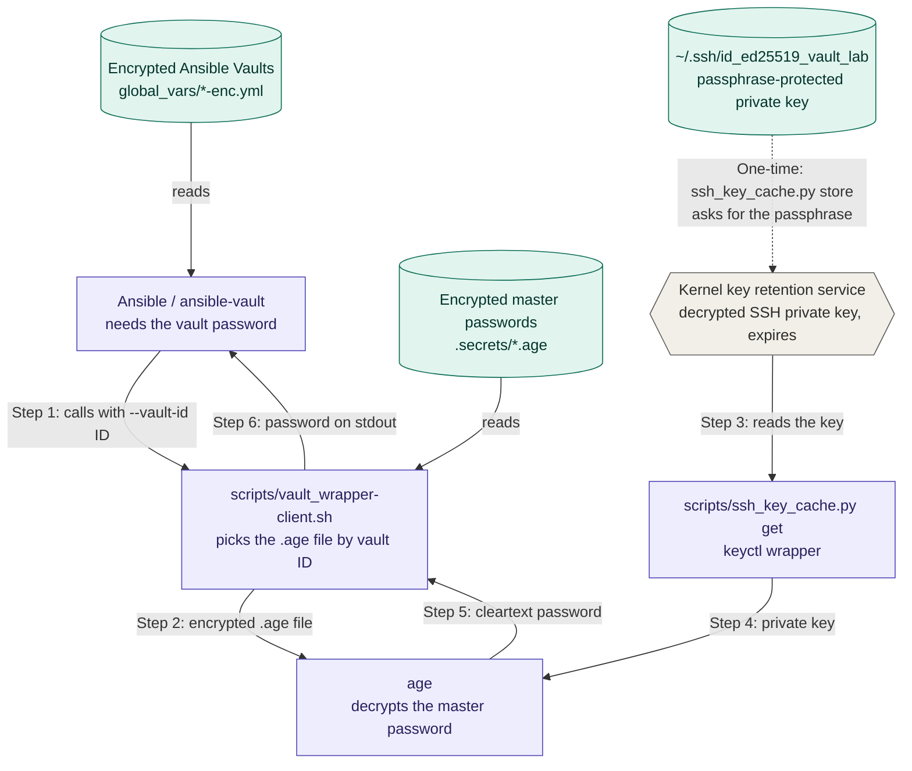

# Ansible Vault

A complete guide to Ansible Vault with `age` and SSH keys:

* Multiple Ansible Vault files
  - A global Ansible Vault for the main project
    * global_vars/global-ansible-vault-enc.yml
  - A personal Ansible Vault for each engineer
    * global_vars/personal-ansible-vault-enc.yml
* Ansible Vault master passwords encrypted at rest with SSH keys
  - .secrets/.global-ansible-vault.age
  - .secrets/.personal-ansible-vault.age
* SSH private key encrypted with a passphrase


# Workflow for Ansible Vault

This workflow shows how to create and manage multiple Ansible Vaults. Run these commands inside the DevContainer, since the environment requires `ansible-vault` and `age`.

Each Ansible Vault is encrypted with its own master password. That master password is then encrypted with `age`, either with the SSH public keys of every team member or with just your own SSH public key. Any **one** matching private key can decrypt it.

We will create two Ansible Vaults, each structured as a dictionary under the **same** top-level key (`vault`):

* A global vault with all the secrets for the switches.
* A user-specific vault with the CloudVision token.

> ⚠️ **Same top-level key ≠ automatic merge.** With Ansible's default `hash_behaviour = replace`, when two vars files define the same top-level key, the one loaded last **replaces** the other entirely. The two vaults are only merged if you set `hash_behaviour = merge` in `ansible.cfg` (discouraged by Ansible but supported), or combine them yourself with the `combine` filter. If the files are loaded by the `arista.avd.global_vars` plugin, check how it merges files before relying on it.
> 📌 This workflow assumes the SSH private key is encrypted with a passphrase.

## How decryption works

When Ansible needs a vault password, it calls the wrapper script with the vault ID. The wrapper sends the matching encrypted master password to `age`, which decrypts it with the SSH private key that `ssh_key_cache.py` reads from the kernel keyring. The cleartext password goes back to Ansible on `stdout`. The dotted arrow is a one-time setup step.



> 📌 Purple boxes are programs, green cylinders are files on disk, and the grey hexagon is kernel memory.

We will create two Ansible Vaults, each structured as a dictionary under the **same** top-level key (`vault`):

* A global vault with all the secrets for the switches.
* A user-specific vault with the CloudVision token.

> ⚠️ **Same top-level key ≠ automatic merge.** With Ansible's default `hash_behaviour = replace`, when two vars files define the same top-level key, the one loaded last **replaces** the other entirely. The two vaults are only merged if you set `hash_behaviour = merge` in `ansible.cfg` (discouraged by Ansible but supported), or combine them yourself with the `combine` filter. If the files are loaded by the `arista.avd.global_vars` plugin, check how it merges files before relying on it.
> 📌 This workflow assumes the SSH private key is encrypted with a passphrase.

## Create the secrets directory

Create a dedicated directory for:

* The encrypted Ansible Vault master password(s).
* The cleartext vault files while you edit them.
* The optional list of team SSH public keys.

```bash
mkdir .secrets
```

> 📌 The wrapper script that decrypts the master passwords lives in `scripts/`, and the encrypted Ansible Vault files are created in `global_vars/`.

### Source control (.gitignore)

Make sure your `.gitignore` contains at least the following entries. They keep the `.secrets/` directory and any file matching `*vault*` out of source control, even if those files are encrypted.

```text
.secrets/
*vault*
*.age
```

> ⚠️ `*vault*` also matches files you probably **do** want to commit, such as `scripts/vault_wrapper-client.sh`, the templates `global-ansible-vault.yml` and `personal-ansible-vault.yml`, and the encrypted vaults in `global_vars/`. Re-include what you need with negation patterns placed **after** `*vault*`, for example:
>
> ```text
> !scripts/vault_wrapper-client.sh
> ```
>
> Also note that because `.secrets/` is ignored, the team-encrypted master password (`.global-ansible-vault.age`) never reaches Git. You'll need another way to share it with the team, or commit that one file deliberately: it is safe to share because only the listed private keys can decrypt it.

## 🔐 Generate personal SSH keys (optional)

You can use existing SSH keys or generate new ones for the project. `age` can encrypt to either `ed25519` or `rsa` SSH keys.

> 📌 `ed25519` is highly recommended.
> 📌 This workflow assumes the `${HOME}/.ssh` directory is mapped from the host into your DevContainer.

```bash
# Select the directory to store your keys
SSH_DIRECTORY="${HOME}/.ssh"
ssh-keygen -q -t ed25519 -C "email@example.com" -f "${SSH_DIRECTORY}/id_ed25519_vault_lab"
# RSA alternative:
# ssh-keygen -q -t rsa -b 4096 -C "email@example.com" -f "${SSH_DIRECTORY}/id_rsa_vault_lab"
```

You will be asked for a passphrase to encrypt your private key. If you don't want to encrypt it, add `-N ''` to `ssh-keygen`.

This command creates the key pair without asking for a passphrase:

```bash
ssh-keygen -q -t ed25519 -N '' -C "My SSH Key for Ansible Vault" -f "${SSH_DIRECTORY}/id_ed25519_vault_lab"
```

> ⚠️ Don't feed `<<<y` to `ssh-keygen` to skip its prompt: that answer is "yes, overwrite", and it silently replaces an existing key with the same name. If the old key encrypted a master password, you lose access to it.

## Create a file with public SSH keys (optional)

To encrypt the Ansible Vault master password for several people, put all the authorized public keys in one text file. The master password is encrypted to every key in the file, and any **one** matching private key can decrypt it.

This file contains only public keys, so it needs no special protection and can be shared over an unsecured channel.

> 📌 The recommended filename is `team_ssh_keys.txt`. Lines starting with `#` are treated as comments by `age`.

```bash
cat <<EOF > .secrets/team_ssh_keys.txt
ssh-ed25519 AAAAC3NzaC1lZDI1NTE5AAAAIGH1+AzG4ewffbeJCaBO8G7zE/pTCAxkOeRoUEocuWvH alice@example.com
ssh-ed25519 AAAAC3NzaC1lZDI1NTE5AAAAIC9SIgGTLAt2ApqDlfy8CTnzRpiCv/GvqrqIqfMhtOXW bob@example.com
ssh-ed25519 AAAAC3NzaC1lZDI1NTE5AAAAIGtm1KWcPeloH1XEQGv4dVLlX9D+xlLOlnhZy2+gSKcu eve@example.com
ssh-ed25519 AAAAC3NzaC1lZDI1NTE5AAAAIIJ6Lp60VWKC6sB5kB8Xs+13N+Ldv8qWy2MgfJhHB6dk email@example.com
EOF
```

> 🕵 I've included Eve's key because she'll eventually be eavesdropping. Joke aside, everyone in this file can decrypt the master password, so review it carefully before you encrypt.

## 🤝 Naming convention

Naming used in this tutorial:

| Cleartext file | Encrypted file | Usage | Vault ID |
| --- | --- | --- | --- |
| `global-ansible-vault.yml` | `global-ansible-vault-enc.yml` | Global secrets | `global` |
| `personal-ansible-vault.yml` | `personal-ansible-vault-enc.yml` | Personal secrets | `personal` |
| `.global-ansible-vault.txt` | `.global-ansible-vault.age` | Master password for the `global` vault (example: `password123`) | `global` |
| `.personal-ansible-vault.txt` | `.personal-ansible-vault.age` | Master password for the `personal` vault (example: `password456`) | `personal` |

🚫❌🙅⛔ Never write your real passwords down like this. I did it only so you can follow the tutorial. 🚫❌🙅⛔

---

# 🌐 🏛️ Global Vault

This creates the global Ansible Vault with all the secrets for the project. Its master password is encrypted with the public keys of all authorized team members.

> 📌 This is usually done by only one member of the team.

## Step 1: 🔐 Encrypt the Ansible Vault master password

First, create a temporary file containing the cleartext master password. This is the password `ansible-vault encrypt` will use.

```bash
INPUT_FILE=".secrets/.global-ansible-vault.txt"
vi "${INPUT_FILE}"
```

> ⛔ Don't use `echo -n "my-super-secret" > .secrets/.global-ansible-vault.txt`, because the cleartext password will be recorded in your shell history.
> 📌 `vi` adds a newline at the end of the file. That's fine: Ansible strips trailing `\r\n` from the output of a password client script.

Encrypt the master password file with `age`, using the public keys of every team member:

```bash
INPUT_FILE=".secrets/.global-ansible-vault.txt"
ENCRYPTED_FILE=".secrets/.global-ansible-vault.age"
PUBLIC_KEYS_FILE=".secrets/team_ssh_keys.txt"

age -R "${PUBLIC_KEYS_FILE}" "${INPUT_FILE}" | base64 -w 0 > "${ENCRYPTED_FILE}"

# ❗🗑️ Important: securely remove the cleartext password once encryption is complete
shred -u -v -n 3 "${INPUT_FILE}"
```

> 📌 `shred` can't guarantee the data is gone on copy-on-write or journaling filesystems (for example Btrfs, ZFS, or a container's overlay filesystem), and `vi` may have left a swap file. Treat `shred` as best effort.

## Step 2: 🔓 Decrypt the Ansible Vault master password (optional)

To verify the encryption, decrypt the password with your SSH private key. If the private key is encrypted, `age` asks for its passphrase.

```bash
ENCRYPTED_FILE=".secrets/.global-ansible-vault.age"
PRIVATE_KEY="${HOME}/.ssh/id_ed25519_vault_lab"
base64 -d "${ENCRYPTED_FILE}" | age -d -i "${PRIVATE_KEY}"
```

> 📌 The output must be the password you encrypted in the previous step.

## 🏛️ Step 3: Create the Ansible Vault file

Create the initial cleartext vault file from the template `global-ansible-vault.yml` and save it in the `.secrets/` directory:

```bash
cp global-ansible-vault.yml .secrets/
```

Edit `.secrets/global-ansible-vault.yml` and modify, add or delete values as needed.

> 🚫 Don't change the top-level key `vault`.

## 🎁 Step 4: Cache the SSH private key in the kernel keyring

If your SSH private key is encrypted, `age` asks for its passphrase every time it uses the key. To avoid that, you can store the decrypted key in the Linux kernel's **key retention service**. That service holds secrets such as passwords, Kerberos tickets, encryption keys and certificates in kernel memory, so they never sit in a file, and access to them is controlled.

From userspace, you talk to the key retention service with a tool like **keyctl**. The script `scripts/ssh_key_cache.py` is a wrapper around `keyctl`.

> ⚠️ While cached, the decrypted private key is available to any process that can reach your keyring. Keep the timeout as short as your workday allows.

**Gotchas**

- A key disappears when its last keyring link is dropped. A key held only in the session keyring (`@s`) is lost when the session ends.
- Containers and `sudo` can land in a different session keyring than you expect, so "key not found" is often a scoping issue. Check with `keyctl show`.
- Permission masks have separate possessor, user, group and other fields. "Possessor" means you can reach the key through your own keyrings.

This command decrypts the SSH private key and stores it in the key retention service under the name `global-secrets` for 8 hours:

```bash
scripts/ssh_key_cache.py store ~/.ssh/id_ed25519_vault_lab --hours 8 --name global-secrets
```

To read the secret, use the `get` argument and pipe the result to any program that needs it to decrypt the master password:

```bash
scripts/ssh_key_cache.py get --name global-secrets | <some other utility>
```

## 🎁 Step 5: Wrapper script

Ansible calls the wrapper script with two arguments:

```bash
scripts/vault_wrapper-client.sh --vault-id global
```

Requirements for an Ansible Vault password client script:

* The filename must end in `-client` or `-client.EXTENSION`.
* The file must be executable.
* The script must:
  * Print the password to standard output.
  * Accept a `--vault-id` option.
  * Display any prompts (for example, the SSH key passphrase) on the TTY, not on standard output.

Reference script, `scripts/vault_wrapper-client.sh`. It uses the key cached in Step 4, or the key file in `AGE_PRIVATE_KEY` if that variable is set:

> 📌 Exit with an error for an unknown vault ID rather than printing a default password: a wrong ID then fails loudly instead of producing a confusing decryption error.
> 📌 If you're **not** using the key cache from Step 4, point the script at your key file:
> `export AGE_PRIVATE_KEY="${HOME}/.ssh/id_ed25519_vault_lab"`

### 🧪 Verification

To test the wrapper script, run it manually with `--vault-id` followed by the vault ID (`global` or `personal`):

```bash
scripts/vault_wrapper-client.sh --vault-id global
```

It should print the cleartext master password on `stdout`.

## Step 6: ansible.cfg

Ansible looks for its configuration in this order and uses the first one it finds: the `ANSIBLE_CONFIG` environment variable, `ansible.cfg` in the current directory, `~/.ansible.cfg`, then `/etc/ansible/ansible.cfg`. If you run `ansible-vault` from another folder, set the path explicitly:

```bash
export ANSIBLE_CONFIG="/workspaces/Ansible-Vault/ansible.cfg"
```

> ⚠️ Ansible ignores an `ansible.cfg` in the current directory if that directory is world-writable, which is common with mounted volumes in DevContainers. Setting `ANSIBLE_CONFIG` avoids the problem.

Your `ansible.cfg` should look like this:

```ini
[defaults]
vault_identity_list = global@scripts/vault_wrapper-client.sh, personal@scripts/vault_wrapper-client.sh
```

> 📌 This is for the `global` environment.

## Step 7: Encrypt the Ansible Vault

Create the encrypted version of the global vault from the cleartext file:

```bash
export VAULT_FILE_CLEAR=".secrets/global-ansible-vault.yml"
export VAULT_FILE_ENC="global_vars/global-ansible-vault-enc.yml"
export VAULT_ID="global"

# Override the vault identity list, because the 'personal' vault doesn't exist yet
# and Ansible would otherwise fail calling the wrapper for it.
ANSIBLE_VAULT_IDENTITY_LIST="global@scripts/vault_wrapper-client.sh" \
  ansible-vault encrypt "${VAULT_FILE_CLEAR}" --encrypt-vault-id "${VAULT_ID}" --output "${VAULT_FILE_ENC}"
```

* The encrypted vault lives in `<repo name>/global_vars` and is defined globally.
* See the [naming convention](#-naming-convention) for the encrypted filename.

> ❗ Because `ansible-vault encrypt` calls the wrapper script to get the master password, it fails if any earlier step went wrong.
> 📌 Once the encrypted file is in place, you can `shred` the cleartext copy in `.secrets/` and make future changes with `ansible-vault edit global_vars/global-ansible-vault-enc.yml`, which never leaves a cleartext file behind.

## 🔎 Step 8: Read the Ansible Vault

This command decrypts the global vault and prints the result on `stdout`. The password comes from `vault_identity_list`:

```bash
ansible-vault view global_vars/global-ansible-vault-enc.yml
# or, without a pager:
ansible-vault decrypt --output - global_vars/global-ansible-vault-enc.yml
```

> ⚠️ Don't pass `--vault-id global` on its own: without an `@source`, Ansible treats `global` as the path to a password file and fails with `The vault password file .../global was not found`. To name the source explicitly, use `--vault-id global@scripts/vault_wrapper-client.sh`.

---

# 🧑🏻‍💻 🎟️ Personal token for CVaaS

This creates a second Ansible Vault for your personal secrets.

## Step 1: 🔐 Encrypt the Ansible Vault master password

First, create a temporary file containing the cleartext master password. This is the password `ansible-vault encrypt` will use.

```bash
INPUT_FILE=".secrets/.personal-ansible-vault.txt"
vi "${INPUT_FILE}"
```

> ⛔ Don't use `echo -n "my-super-secret" > .secrets/.personal-ansible-vault.txt`, because the cleartext password will be recorded in your shell history.

Encrypt the master password file with `age`, this time with **only** your public key, so only you can decrypt it:

```bash
INPUT_FILE=".secrets/.personal-ansible-vault.txt"
ENCRYPTED_FILE=".secrets/.personal-ansible-vault.age"
PUBLIC_KEY="${HOME}/.ssh/id_ed25519_vault_lab.pub"

# Encrypt the password and save it to a file
age --encrypt -R "${PUBLIC_KEY}" "${INPUT_FILE}" | base64 -w 0 > "${ENCRYPTED_FILE}"

# ❗🗑️ Important: securely remove the cleartext password once encryption is complete
shred -u -v -n 3 "${INPUT_FILE}"
```

## Step 2: 🔓 Decrypt the Ansible Vault master password (optional)

To verify the encryption, decrypt the password with your SSH private key:

```bash
ENCRYPTED_FILE=".secrets/.personal-ansible-vault.age"
PRIVATE_KEY="${HOME}/.ssh/id_ed25519_vault_lab"
base64 -d "${ENCRYPTED_FILE}" | age -d -i "${PRIVATE_KEY}"
```

> 📌 The output must be the password you encrypted in the previous step.

## 🏛️ Step 3: Create the personal Ansible Vault file

Create your initial cleartext personal vault from the template `personal-ansible-vault.yml` and save it in the `.secrets/` directory:

```bash
cp personal-ansible-vault.yml .secrets/
```

Edit `.secrets/personal-ansible-vault.yml` and fill in your secrets.

## 🎁 Step 4: Wrapper script

The wrapper script was created in the global vault section. It decrypts `.personal-ansible-vault.age` with your SSH private key.

If your script doesn't handle `personal` yet, add this branch so it knows how to decrypt the `personal` vault's master password:

```bash
### Personal secrets
elif [[ "${VAULT_ID}" == "personal" ]]; then
  base64 -d .secrets/.personal-ansible-vault.age \
  | age -d -i <(python3 scripts/ssh_key_cache.py get --name personal-secrets)
```

## 🔑 Step 5: Store the private key

Decrypt your SSH private key and store it in the kernel key retention service:

```bash
scripts/ssh_key_cache.py store ~/.ssh/id_ed25519_vault_lab --hours 8 --name personal-secrets
```

> 📌 This is the same SSH key as `global-secrets`. Caching it under two names keeps the vaults independent (for example, if the global vault later uses a team key), but you could point both branches of the wrapper at one name.

To read the secret, use the `get` argument and pipe the result to any program that needs it. `show` displays information about the cached key:

```bash
scripts/ssh_key_cache.py get --name personal-secrets | <some other utility>
scripts/ssh_key_cache.py show --name personal-secrets
```

### 🧪 Verification

To test the wrapper script, run it manually with `--vault-id` followed by the vault ID (`global` or `personal`):

```bash
scripts/vault_wrapper-client.sh --vault-id personal
```

It should print the cleartext master password on `stdout`.

## 🔐 Step 6: Encrypt the personal Ansible Vault

Create the encrypted version of your personal vault from the cleartext file:

```bash
export VAULT_FILE_CLEAR=".secrets/personal-ansible-vault.yml"
export VAULT_FILE_ENC="global_vars/personal-ansible-vault-enc.yml"
export VAULT_ID="personal"

ansible-vault encrypt "${VAULT_FILE_CLEAR}" --encrypt-vault-id "${VAULT_ID}" --output "${VAULT_FILE_ENC}"
```

* The encrypted vault must live in `<repo name>/global_vars` and is defined globally.

> ❗ Because `ansible-vault encrypt` calls the wrapper script for **every** ID in `vault_identity_list`, it fails if any earlier step (global or personal) went wrong.

## 🔎 Step 7: Read the personal Ansible Vault

This command decrypts the personal vault and prints the result on `stdout`:

```bash
ansible-vault view global_vars/personal-ansible-vault-enc.yml
# or, without a pager:
ansible-vault decrypt --output - global_vars/personal-ansible-vault-enc.yml
```

## 📚 Step 8: Read the Ansible Vaults with a playbook

Run the playbook `playbooks/read_vaults.yml`. It prints some values from both vaults:

```bash
ansible-playbook -i localhost, -c local -e "user=DDN" playbooks/read_vaults.yml
```

> 📌 If values from one vault are missing, the two `vault` dictionaries were replaced rather than merged. See the note at the top of [Workflow for Ansible Vault](#workflow-for-ansible-vault).
