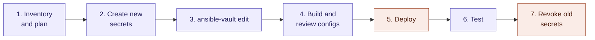

# Rotate the secrets inside an Ansible Vault

This guide changes the **secrets stored inside** the Ansible Vaults (switch passwords, keys, the CloudVision token) and pushes the new values to the devices and services that use them.

It's the companion to `Change_Ansible_Vault_Master_Password.md`:

| Guide | What changes | Devices touched? |
| --- | --- | --- |
| `Change_Ansible_Vault_Master_Password.md` | The password that **locks** the vault | No |
| `Rotate_Ansible_Vault_Secrets.md` (this one) | The secrets **inside** the vault | Yes |

> ⚠️ When someone leaves the team or an SSH key is compromised, do **both**: changing the master password alone doesn't help, because that person may have kept a copy of the vault's contents.



> 📌 The variable names in this guide (`vault.local_users`, `vault.bgp_password` and so on) are examples. Use the keys that actually exist in your `global-ansible-vault.yml` and `personal-ansible-vault.yml` templates.

## When to rotate

* A team member who could open the `global` vault leaves, or their SSH key is lost or compromised.
* A secret was exposed (pasted in a ticket or chat, committed, shown in a screen share).
* A CloudVision token is about to expire.
* Your regular rotation schedule says so.

## Prerequisites

Run everything inside the DevContainer, from the repo root:

```bash
cd /workspaces/Ansible-Vault
export ANSIBLE_CONFIG="/workspaces/Ansible-Vault/ansible.cfg"
```

Check that both vaults open before you change anything:

```bash
ansible-vault view global_vars/global-ansible-vault-enc.yml > /dev/null && echo "✅ global"
ansible-vault view global_vars/personal-ansible-vault-enc.yml > /dev/null && echo "✅ personal"
```

Make sure the editor `ansible-vault edit` will open is the one you want:

```bash
export EDITOR=vi
```

## Step 1: Inventory the secrets and plan the order

List the keys in each vault, **without** printing the values:

```bash
ansible-vault view global_vars/global-ansible-vault-enc.yml \
  | python3 -c 'import sys,yaml
def walk(d,p=""):
    for k,v in d.items():
        walk(v,f"{p}{k}.") if isinstance(v,dict) else print(f"{p}{k}")
walk(yaml.safe_load(sys.stdin))'
```

For each secret, write down in your change ticket:

* **Where it's used:** which devices or services, and which side(s) must change together.
* **Impact while it changes:** none, a session drop, or a possible lockout.
* **How to revoke the old value** once the new one works.

Typical secrets in an AVD project and how to handle them:

| Secret | Impact while it changes | Approach |
| --- | --- | --- |
| Local user passwords (`sha512_password`) | Lockout risk if it's the account Ansible or CloudVision uses to log in | Two-phase change (see Step 2) |
| `enable` password | Low | Change in one deploy |
| BGP neighbor passwords | **Sessions drop** until both peers have the new key | Maintenance window; deploy both ends in the same change |
| OSPF / IS-IS authentication keys | **Adjacencies drop** until both sides match | Maintenance window; deploy all routers in the area together |
| TACACS+ / RADIUS shared keys | Remote AAA logins fail until the server and switches match | Change the server first, keep local login as fallback |
| SNMP communities / SNMPv3 keys | Monitoring gaps | Add the new one, update the NMS, then remove the old one |
| CloudVision service account token | Playbooks can't reach CloudVision | Create new token, test, then delete the old one |

> 📌 Rotate the low-impact secrets first. Keep the account Ansible uses to connect for last, so you never lose the ability to fix things.

## Step 2: Create the new secret values

Never type a new secret on the command line: it ends up in your shell history. Generate it **inside the editor** in Step 3 instead. In `vi`, these commands insert a value at the cursor without touching your history:

```vim
" Random password, 24 bytes
:r !openssl rand -base64 24

" SHA-512 hash for an EOS local user (prompts for the password twice)
:r !openssl passwd -6
```

> ⚠️ `openssl passwd -6` prints only the hash. Store the cleartext password in your team's password manager **before** you leave the editor, or nobody will be able to log in with that account.

### Two-phase change for the login account

If you change the password of the account that Ansible or CloudVision uses to connect, the deploy can lock itself out halfway. Split it in two:

1. **Phase 1:** create a second admin account (or a temporary password on another account) with the new credentials, deploy, and confirm you can log in with it.
2. **Phase 2:** change the original account's password, point the connection variables (for example `ansible_password`, `cv_token`) at the new values, deploy, test, then remove the temporary account.

### CloudVision token (personal vault)

In CloudVision, generate a **new** service account token before you touch the vault. Leave the old token in place until Step 6 passes. Note its expiry date in your calendar so the next rotation isn't a surprise.

## Step 3: Edit the vault

`ansible-vault edit` decrypts the vault into a temporary file, opens your editor, and encrypts it again when you save and quit. The vault keeps its vault ID (`global` or `personal`), and no cleartext copy is left behind.

First, keep a backup in case you need to roll back:

```bash
cp -p global_vars/global-ansible-vault-enc.yml global_vars/global-ansible-vault-enc.yml.bak
```

Then edit:

```bash
ansible-vault edit global_vars/global-ansible-vault-enc.yml
```

Replace the values you planned in Step 1. Example (values shortened):

```yaml
vault:
  local_users:
    admin:
      sha512_password: "$6$Kq3...new-hash..."
  bgp_password: "bU9x...new-value..."
  tacacs_key: "7Hc2...new-value..."
```

> 🚫 Don't change the top-level key `vault` or rename any key: playbooks and templates refer to them by name.

For your CloudVision token, edit the personal vault the same way:

```bash
cp -p global_vars/personal-ansible-vault-enc.yml global_vars/personal-ansible-vault-enc.yml.bak
ansible-vault edit global_vars/personal-ansible-vault-enc.yml
```

Check the vault still opens, still has the right vault ID, and is still valid YAML:

```bash
head -1 global_vars/global-ansible-vault-enc.yml        # must end with ;global
ansible-vault view global_vars/global-ansible-vault-enc.yml | python3 -c 'import sys,yaml; yaml.safe_load(sys.stdin); print("✅ valid YAML")'
```

## Step 4: Build and review the configurations

Run the AVD build only (no deployment), then check that the **only** changes are the secrets you rotated:

```bash
ansible-playbook playbooks/<your-build-playbook>.yml --tags build
git diff --stat -- intended/
git diff -- intended/ | grep '^[-+]' | grep -v '^[-+][-+]' | less
```

You should see changed lines only for the rotated secrets (for example `username admin ... secret sha512`, `neighbor ... password 7`, `tacacs-server key 7`). Anything else is unexpected: stop and investigate.

> ⚠️ Intended configurations contain hashes and type-7 keys. Type 7 is reversible, so treat these files as secrets: if `intended/` is committed, the old and new values end up in Git history. Consider adding `intended/` to `.gitignore` for this project.

## Step 5: Deploy

Schedule a maintenance window if any secret in Step 1 causes session or adjacency drops, and warn the people who monitor the network.

Deploy through your usual path (for example a CloudVision change control created by your deploy playbook):

```bash
ansible-playbook playbooks/<your-deploy-playbook>.yml
```

Rules for the deploy:

* Deploy **both ends** of every BGP session and every routing adjacency in the same change.
* For TACACS+ or RADIUS, update the server first, then the switches.
* Keep a console or out-of-band session open on at least one device until Step 6 passes.

## Step 6: Test

**1. The playbook can read both vaults:**

```bash
ansible-playbook -i localhost, -c local -e "user=DDN" playbooks/verify_global_secrets.yml
```

**2. Logins work with the new credentials:** log in to a few switches with each rotated account, over SSH and through TACACS+/RADIUS if used.

**3. The old credentials no longer work:** try the old password on one switch. It must be refused.

**4. Routing is back to normal.** On the switches:

```text
show bgp evpn summary
show ip bgp summary vrf all
show ip ospf neighbor
```

Every session must be `Established` (or `FULL` for OSPF), with the same count as before the change.

**5. Automation still works:** run a read-only playbook against CloudVision and the switches, using the new token and connection credentials.

**6. Monitoring still works:** check that SNMP polling and AAA accounting are receiving data.

## Step 7: Revoke the old secrets and clean up

When every test passes:

* **CloudVision:** delete the old service account token.
* **Phase 2 of the login account:** remove the temporary admin account if you created one.
* **SNMP:** remove the old community or SNMPv3 user from the switches and the NMS.
* **Password manager:** update the entries and archive the old values.

Remove the vault backups and commit:

```bash
rm -f global_vars/global-ansible-vault-enc.yml.bak global_vars/personal-ansible-vault-enc.yml.bak
git add -f global_vars/global-ansible-vault-enc.yml   # -f because *vault* is in .gitignore
git commit -m "Rotate global Ansible Vault secrets"
git push
```

> 📌 The personal vault holds your own CloudVision token. Decide with your team whether personal vaults are committed at all. If they're not, don't `git add` it.

## Rollback

**Before the deploy (Step 3 or 4 went wrong):** restore the vault backup. Nothing has changed on the devices.

```bash
mv global_vars/global-ansible-vault-enc.yml.bak global_vars/global-ansible-vault-enc.yml
```

**After the deploy:** the devices now hold the new secrets, so restoring the old vault is **not** enough. Either:

* fix forward: correct the value in the vault with `ansible-vault edit` and deploy again, or
* roll back the device configuration through the CloudVision change control's rollback, **then** restore the vault backup so both match.

> ⚠️ The vault and the devices must always agree. A vault that holds different secrets from the switches breaks the next deploy, and for login credentials it can lock automation out.

## Checklist

- [ ] Both vaults open before starting
- [ ] Secrets listed, impact and order planned, maintenance window booked if needed
- [ ] New CloudVision token created (old one still active)
- [ ] New cleartext passwords saved in the password manager
- [ ] Vault backups taken
- [ ] Vaults edited; vault ID and YAML checked
- [ ] Build diff shows only the rotated secrets
- [ ] Deployed; console session kept open
- [ ] Tests 1–6 passed
- [ ] Old token, temporary accounts and old SNMP credentials removed
- [ ] Backups deleted, change committed
- [ ] If someone left the team: master password also rotated (`Change_Ansible_Vault_Master_Password.md`)
